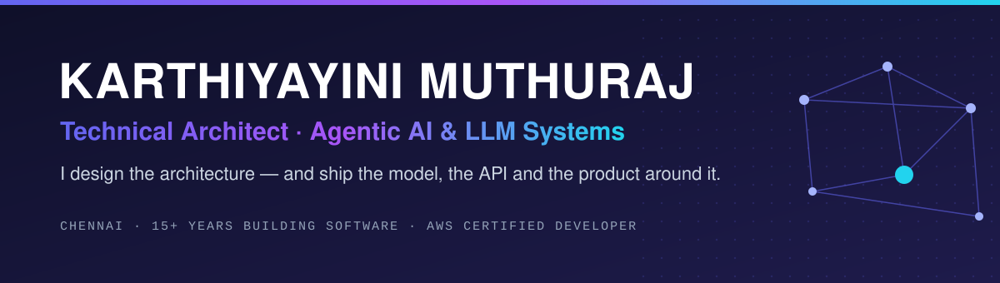

  

  
  
  
  

## Hi, I'm Karthiyayini

I'm a Technical Architect with 15+ years of building software. I design AI systems and I still write the code that ships them.

What I work on:

- **LLM platforms and agent workflows** — the AI "brain" behind products: agents, automatic form filling, report generation and RAG over company documents
- **Natural language to SQL** — ask a question in plain English, get the query and the report (Vanna SDK, ChromaDB)
- **Full-stack products around the AI** — Python and FastAPI APIs, Laravel and Angular/React apps, including large legacy upgrades
- **AI-assisted development for teams** — Claude Code skills, agents and MCP integrations, plus the training that gets developers using them every day

Most of that code is private. What you'll find here is the work I can share.

## Things I built

### [Claude SDLC Plugin](https://github.com/karthigamuthuraj/claude-sdlc-plugin)

A Claude Code plugin that runs a developer's whole lifecycle on one Jira ticket. Claude drafts the root cause, design and code; a person approves each gate by typing a line, and hooks block unsafe git commands and secret files.

Claude Code · MCP · Jira · Node 18

### [SmartForm AI](https://github.com/karthigamuthuraj/smartform-ai)

Fills any PDF form from a plain-English description — no per-form field mapping. Static PDFs become fillable, Document Intelligence labels the fields, and GPT-4o maps the user's data onto them.

Azure OpenAI · Azure Document Intelligence · Flask · PyMuPDF

### [QA Test Case Generator](https://github.com/karthigamuthuraj/ai-qa-test-case-generator)

AutoGen agents turn a user story into functional, regression, integration, performance and security test cases, exported as CSV. Runs fully local.

AutoGen · Ollama · Llama 3.2 · Streamlit

### [Speaker Diarization](https://github.com/karthigamuthuraj/audio-transcription-speaker-diarization)

Multilingual transcription that detects the language and labels who said what.

Whisper · PyAnnote · Streamlit

### [Video Summarizer](https://github.com/karthigamuthuraj/Automated-Video-Summarization)

Transcribes a long video, summarizes it and marks the scene changes.

Whisper · Hugging Face · Streamlit

### [AI Projects Lab](https://github.com/karthigamuthuraj/AI-Projects)

Machine learning, deep learning, NLP and data-science notebooks — the foundations under the LLM work.

Python · TensorFlow · Jupyter

## How I build

- **Architecture first.** Clear boundaries between the UI, the API and the LLM layer, so each can change without breaking the others.
- **The model drafts. Code checks.** Every LLM step has a validation step after it before anything reaches a user.
- **People approve what matters.** Commits, merges, status changes and risky changes wait for a human.
- **AI is a team skill.** A tool only counts once the whole team uses it day to day, so I build the skills and run the training.

## Tools I work with

Before AI, I spent over a decade building PHP and full-stack products with Laravel, CodeIgniter, React and Angular. That's why I treat the API, the data and the integrations as part of the AI system, not an afterthought. AWS Certified Developer — Associate.
